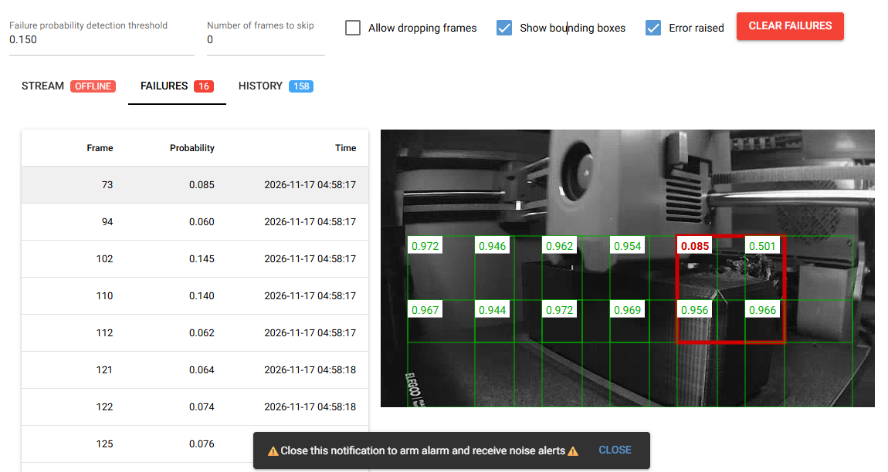

## Printer Guardian


Web application to monitor Elegoo Centauri Carbon's webcam for spaghetti 3D printing errors using an AI model running using GPU acceleration on Windows using DirectML.

### Usage Instructions
1. Create python virtual environment for python 3.13: ```python -m venv venv```
2. Activate python virtual environment: ```source ./venv/Scripts/activate``` or ```source ./venv/bin/activate```
3. Install python dependencies ```pip install -r requirements.txt```
4. Run one of the commands below

| Action | Command |
| --- | --- |
| Monitor Elegoo Carbon Centauri from app | ```python ./run_printer_web_app.py --ip [ip]``` |
| Test web app on video file or url stream | ```python ./run_local_web_app.py [url\|path]``` |
| Run model on video file or stream | ```python ./process_video_stream.py [url\|path]``` |
| Run model on single image file | ```python ./process_single_image.py [path]``` |
| Test Elegoo Centauri Carbon connection | ```python ./test_centauri_connection.py --ip [ip]``` |
| Configure and export bounding boxes for printer webcam | Open ```./create_bounding_boxes.html``` in a browser |

- For help run: ```python [file] --help```
- There are test files in ```/data``` which can be used with the above commands
- There are bounding box configurations in ```/configs``` which can be passed via ```--bbox-config [path]```

### Changing or adding onnxruntime execution providers
To use a different onnxruntime for inference install reference to the other commented out ```onnxruntime-?==x.x.x``` packages in ```requirements.txt```

| Package Name | Version | Description |
| --- | --- | --- |
| ```onnxruntime``` | ```1.32.0``` | Always installed base package for CPU cross-platform runtime |
| ```onnxruntime-webgpu``` | ```1.27.0``` | WebGPU based GPU accelerated cross-platform runtime |
| ```onnxruntime-directml``` | ```1.24.4``` | DirectML GPU accelerated Windows only runtime (Slightly faster) |

### Attributions
- [oliverbravery/Edge-FDM-Fault-Detection](https://github.com/oliverbravery/Edge-FDM-Fault-Detection): AI model is based off their paper
- [oliverbravery/PrintGuard](https://github.com/oliverbravery/PrintGuard): Specific fine tuned model is from their repository
